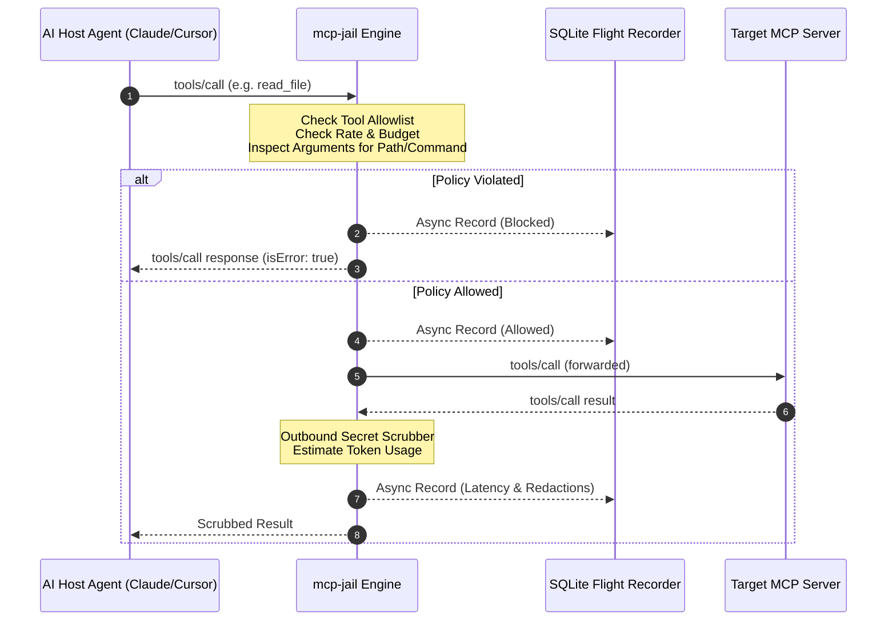

# Architecture & Design

Understand how `mcp-jail` transparently inspects, enforces, and logs MCP stdio streams.

---

## Architectural Principles

1. **Zero Latency Overhead (<1ms)**: Tool calls and response parsing occur via zero-allocation buffered scanners; database writes occur asynchronously over non-blocking Go channels.
2. **Strict Stdout Hygiene**: `os.Stdout` is strictly reserved for valid JSON-RPC 2.0 messages destined for the Host Agent. All proxy diagnostics and subprocess errors route to `os.Stderr`.
3. **Graceful Self-Correction**: When requests violate security policies, `mcp-jail` injects valid MCP `tools/call` error results (`isError: true`) so the LLM agent self-corrects without crashing.
4. **Single Standalone Pure-Go Binary**: Compiles into a single self-contained binary with no external C dependencies, runtime libraries, or system drivers required, utilizing an embedded pure-Go SQLite engine (`modernc.org/sqlite`).

---

## Data Flow Diagram



---

## Stdio Buffer Engine

MCP messages can contain large file contents or vector payloads. Standard Go `bufio.Scanner` defaults to 64KB tokens, which will panic on larger payloads with `bufio.Scanner: token too long`.

`mcp-jail` configures dynamic buffer allocation supporting up to **16MB** per JSON-RPC line:

```go
const MaxLineSize = 16 * 1024 * 1024 // 16 MB
scanner := bufio.NewScanner(reader)
buf := make([]byte, 64*1024)
scanner.Buffer(buf, MaxLineSize)
```

---

## Request-Response Correlation

Because JSON-RPC 2.0 allows concurrent pipelined calls, `mcp-jail` correlates inbound requests and outbound responses using `id`:

1. When a `tools/call` request passes policy checks, `mcp-jail` saves its `id`, `toolName`, and `startTime` into an internal thread-safe map.
2. When the server returns a response with the corresponding `id`, `mcp-jail`:
   - Calculates exact execution latency in milliseconds (`time.Since(startTime)`).
   - Maps the response to the original tool name.
   - Scrubs outbound credentials before writing to `stdout`.
   - Records the enriched event into the flight recorder.

---

## Subprocess & Signal Management

`mcp-jail` manages the lifecycle of the child MCP server process:
- Passes parent OS signals (`SIGINT`, `SIGTERM`) directly to the child.
- Automatically kills the child if the Host Agent disconnects or hits EOF on `stdin`.
- Propagates the child process's exact exit code when terminating.
