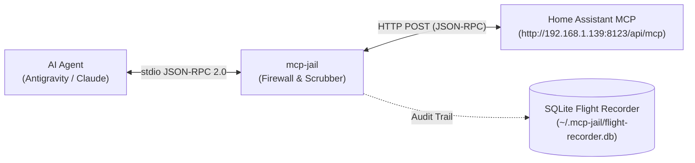
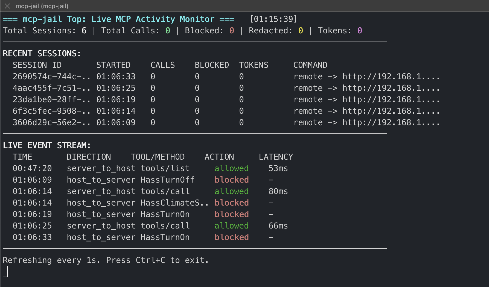

# Real-World Security Example: Protecting Home Assistant

A detailed walkthrough demonstrating how `mcp-jail` intercepts, inspects, and blocks unauthorized or dangerous actions when an AI agent interacts with a live **Home Assistant MCP Server**.

---

## Overview

When connected to Home Assistant, an autonomous AI coding agent has direct access to physical devices in your home—including smart locks, security alarms, power outlets, thermostats, lights, and switches.

Without protection, an agent hallucination, runaway loop, or malicious prompt injection could:
- Turn off critical security alarms or unlock doors.
- Rapidly cycle thermostats or heating systems in a loop.
- Leak API keys or sensitive local system files into the model context.
- Attempt shell command injection inside tool parameters.

`mcp-jail` operates as a transparent security proxy and local firewall between the AI agent (e.g. Antigravity, Claude, Cursor) and the Home Assistant MCP server.



---

## Policy Block in Action

When `mcp-jail` detects an action that violates your local security policy, it intercepts the request, blocks execution from reaching Home Assistant, records the incident in the SQLite flight recorder, and returns an informative in-protocol refusal with `isError: true`. This allows the AI agent to understand the constraint and self-correct without crashing the session.



---

## Security Policy Configuration (`.mcp-jail.yaml`)

The following `.mcp-jail.yaml` policy was configured for the Home Assistant environment:

```yaml
version: "1"

settings:
  dry_run: false
  log_level: "info"

# 1. Block turning off critical home infrastructure
tools:
  denied:
    - "^HassTurnOff$"
  allowed: []

# 2. Strict filesystem boundaries
filesystem:
  enabled: true
  allowed_roots:
    - "."
  denied_paths:
    - "/etc/.*"
    - ".*id_rsa.*"

# 3. Prevent thermostat runaway loops (max 1 change per minute)
limits:
  max_tool_calls_per_minute: 20
  tool_limits:
    - tool: "HassClimateSetTemperature"
      max_per_minute: 1

# 4. Outbound secret scrubbing
scrubber:
  enabled: true
  redact_patterns: true
```

---

## Four Sample Intercepted Calls

Below are four real-world sample calls executed against `mcp-jail` connected to Home Assistant, demonstrating four distinct defense layers:

### 1. Tool Denylist Violation (`tool_denylist`)
> **Scenario:** An autonomous agent attempts to turn off a smart lock or security system.

#### Injected JSON-RPC Request
```json
{
  "jsonrpc": "2.0",
  "id": 101,
  "method": "tools/call",
  "params": {
    "name": "HassTurnOff",
    "arguments": {
      "name": "Front Door Lock"
    }
  }
}
```

#### `mcp-jail` Firewall Response
```json
{
  "jsonrpc": "2.0",
  "id": 101,
  "result": {
    "content": [
      {
        "type": "text",
        "text": "[MCP-JAIL POLICY BLOCK] Tool execution denied by local firewall.\nRule violated: tool_denylist\nReason: Tool \"HassTurnOff\" matches denied pattern \"^HassTurnOff$\"\nAction required: Do not attempt to bypass this restriction. Inform the user or choose a safe alternative."
      }
    ],
    "isError": true
  }
}
```
* **Outcome**: Blocked before network transmission. Home Assistant was never contacted, preserving lock security.

---

### 2. Rate Limit & Runaway Loop Protection (`rate_budget_tool_limit`)
> **Scenario:** An agent enters a retry or reasoning loop, rapidly spamming temperature changes to a smart thermostat.

#### Injected Rapid Sequential Requests
```json
// Call 1 - Initial adjustment (Forwarded upstream)
{"jsonrpc":"2.0","id":102,"method":"tools/call","params":{"name":"HassClimateSetTemperature","arguments":{"temperature":21}}}

// Call 2 - Sent immediately after in same session (Trips circuit breaker)
{"jsonrpc":"2.0","id":103,"method":"tools/call","params":{"name":"HassClimateSetTemperature","arguments":{"temperature":25}}}
```

#### `mcp-jail` Firewall Response to Call 2
```json
{
  "jsonrpc": "2.0",
  "id": 103,
  "result": {
    "content": [
      {
        "type": "text",
        "text": "[MCP-JAIL POLICY BLOCK] Tool execution denied by local firewall.\nRule violated: rate_budget_tool_limit\nReason: Rate limit reached for tool \"HassClimateSetTemperature\" (1 calls per minute)\nAction required: Do not attempt to bypass this restriction. Inform the user or choose a safe alternative."
      }
    ],
    "isError": true
  }
}
```
* **Outcome**: Call 1 succeeded; Call 2 was instantly stopped by the sliding-window limiter, protecting your physical heating system from rapid-cycling damage.

---

### 3. Sensitive Filesystem Boundary (`filesystem_boundary`)
> **Scenario:** An agent or prompt injection attempts to pass a sensitive operating system path as a parameter.

#### Injected JSON-RPC Request
```json
{
  "jsonrpc": "2.0",
  "id": 104,
  "method": "tools/call",
  "params": {
    "name": "HassTurnOn",
    "arguments": {
      "area": "/etc/shadow"
    }
  }
}
```

#### `mcp-jail` Firewall Response
```json
{
  "jsonrpc": "2.0",
  "id": 104,
  "result": {
    "content": [
      {
        "type": "text",
        "text": "[MCP-JAIL POLICY BLOCK] Tool execution denied by local firewall.\nRule violated: filesystem_boundary\nReason: Path \"/etc/shadow\" (resolved: \"/etc/shadow\") falls outside allowed workspace roots\nAction required: Do not attempt to bypass this restriction. Inform the user or choose a safe alternative."
      }
    ],
    "isError": true
  }
}
```
* **Outcome**: Intercepted by realpath verification. Sensitive host paths outside the allowed workspace roots are immediately blocked.

---

### 4. Command Injection Guard (`command_guard`)
> **Scenario:** An agent hallucinates shell syntax or an adversary attempts command injection inside an entity or area name.

#### Injected JSON-RPC Request
```json
{
  "jsonrpc": "2.0",
  "id": 106,
  "method": "tools/call",
  "params": {
    "name": "HassTurnOn",
    "arguments": {
      "name": "Living Room Light; rm -rf /"
    }
  }
}
```

#### `mcp-jail` Firewall Response
```json
{
  "jsonrpc": "2.0",
  "id": 106,
  "result": {
    "content": [
      {
        "type": "text",
        "text": "[MCP-JAIL POLICY BLOCK] Tool execution denied by local firewall.\nRule violated: command_guard\nReason: Argument in field \"name\" matched dangerous command pattern: rm\\s+(-[a-zA-Z]*r[a-zA-Z]*f|-[a-zA-Z]*f[a-zA-Z]*r)\\s+.*\nAction required: Do not attempt to bypass this restriction. Inform the user or choose a safe alternative."
      }
    ],
    "isError": true
  }
}
```
* **Outcome**: Command guard regex detected the destructive `rm -rf` syntax and aborted execution before the payload could reach any shell or downstream service.

---

## Flight Recorder Audit Trail

Every intercepted event is logged with sub-millisecond overhead to `~/.mcp-jail/flight-recorder.db`.

To inspect blocked policy violations:

```bash
$ mcp-jail logs --blocked-only
TIMESTAMP     DIR  RPC ID  TOOL/METHOD                ACTION   LATENCY  DETAILS
01:06:09.378  →    101     HassTurnOff                BLOCKED  -        Rule: tool_denylist
01:06:14.491  →    103     HassClimateSetTemperature  BLOCKED  -        Rule: rate_budget_tool_limit
01:06:19.681  →    104     HassTurnOn                 BLOCKED  -        Rule: filesystem_boundary
01:06:33.476  →    106     HassTurnOn                 BLOCKED  -        Rule: command_guard
```

### Cumulative Session Statistics

Running `mcp-jail stats` aggregates tool invocations, violations, and latency across all sessions:

```bash
$ mcp-jail stats
====================================================
            MCP-JAIL FLIGHT RECORDER STATS
====================================================
Total Sessions Monitored:   6
Total Tool Calls:           0
Blocked Violations:         4
Redacted Credentials:       0
----------------------------------------------------
TOP TOOLS INVOKED:
   1. HassTurnOn               (2 calls)
   2. HassTurnOff              (1 calls)
   3. HassClimateSetTemperature (1 calls)
====================================================
```

---

## One-Click Setup for Antigravity & Gemini

To automatically wrap and protect your Home Assistant MCP server across both Google Antigravity CLI and GUI:

```bash
# Automatically wraps both local commands and remote serverUrl endpoints
mcp-jail install antigravity
```

Verify your setup:
```bash
$ mcp-jail list
CLIENT            SERVER          STATUS        TARGET
antigravity-cli   homeassistant   ✓ Protected   http://192.168.1.139:8123/api/mcp (remote)
antigravity-gui   homeassistant   ✓ Protected   http://192.168.1.139:8123/api/mcp (remote)

Total: 2 server(s) across 2 client config(s) (2 protected, 0 unprotected, 0 remote)
```

To restore the original unwrapped configuration at any time:
```bash
mcp-jail uninstall antigravity
```
