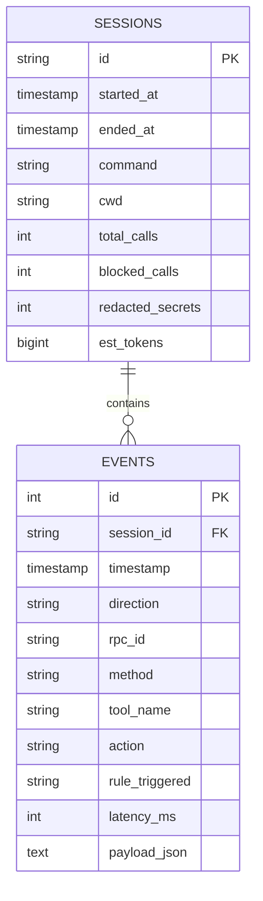

# SQLite Flight Recorder & Audit Trail

The SQLite Flight Recorder provides persistent, queryable compliance and security auditing for all MCP interactions.

---

## Performance & Architecture

- **Sub-millisecond Stdio Latency**: Stdio messages are pushed directly into a 10,000-element buffered Go channel worker. Database I/O runs asynchronously in a dedicated background goroutine.
- **Pure-Go SQLite Engine**: Uses `modernc.org/sqlite` with zero CGO dependencies.
- **WAL Mode**: Operates in SQLite Write-Ahead Logging (`PRAGMA journal_mode = WAL;`) with a 5000ms busy timeout for concurrent query access while sessions are running.
- **Redaction-Safe Storage**: Payloads are stored in their scrubbed form so the flight recorder database itself never leaks credentials.

---

## Database Schema



---

## Querying Audit Logs

### View Recent Events (`mcp-jail logs`)

```bash
mcp-jail logs
```

Output:
```
TIMESTAMP     DIR  RPC ID  TOOL/METHOD  ACTION    LATENCY  DETAILS
14:22:01.120  →    2       read_file    ALLOWED   -        {"jsonrpc": "2.0", "id": 2, "method": "tools/call", "params":...
14:22:01.124  ←    2       read_file    ALLOWED   4ms      {"jsonrpc":"2.0","id":2,"result":{"content":[{"type":"text"...
14:22:05.801  →    3       read_file    BLOCKED   -        Rule: filesystem_boundary
14:22:10.450  →    4       leak_secret  ALLOWED   -        {"jsonrpc": "2.0", "id": 4, "method": "tools/call", "params":...
14:22:10.452  ←    4       leak_secret  REDACTED  2ms      Secrets scrubbed from output
```

### Filter by Session ID or Violations

```bash
# Show only policy violations
mcp-jail logs --blocked-only

# Filter for a specific session
mcp-jail logs --session e2e-session-123 --tail 100
```

---

## Metrics & Statistics (`mcp-jail stats`)

```bash
mcp-jail stats
```

Output:
```
====================================================
            MCP-JAIL FLIGHT RECORDER STATS
====================================================
Total Sessions Monitored:   14
Total Tool Calls:           182
Blocked Violations:         7
Redacted Credentials:       12
Estimated Token Usage:      41920 (~163 KB)
----------------------------------------------------
TOP TOOLS INVOKED:
   1. read_file                (94 calls)
   2. list_directory           (42 calls)
   3. execute_command          (31 calls)
   4. git_status               (15 calls)
====================================================
```
