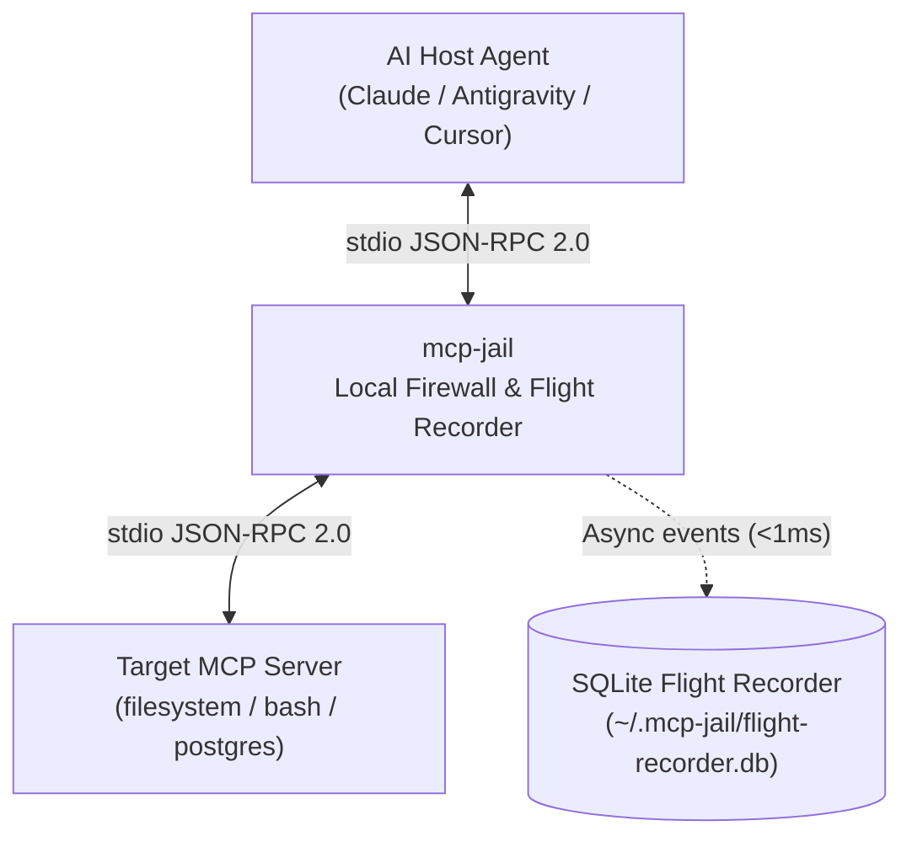

# mcp-jail Documentation

A high-performance, single-binary, zero-CGO local firewall and flight-recorder proxy for Model Context Protocol (MCP) servers and terminal AI coding agents.

---

## Overview

AI coding agents (such as Claude Code, Antigravity, Cursor, and OpenCode) execute MCP servers as local subprocesses communicating via line-delimited JSON-RPC 2.0 over `stdin` and `stdout`.

`mcp-jail` sits transparently between the Host Agent and the Target MCP Server to enforce security boundaries, prevent catastrophic command execution, prevent runaway token loops, and redact outbound credentials before they enter the LLM context window.



> [!IMPORTANT]
> **Strict Stdout Invariant**: When running in `wrap` mode, `mcp-jail` NEVER writes logs, panics, or debug output to `os.Stdout`. `os.Stdout` is strictly reserved for valid JSON-RPC 2.0 messages destined for the Host Agent. All internal logging routes to `os.Stderr` or the SQLite flight recorder.

---

## Navigation

- [Getting Started](getting-started.md) — Installation and initial configuration in 60 seconds.
- [Architecture](architecture.md) — Deep dive into the transparent stdio proxy and sub-millisecond async design.
- [Policy & Firewall Engine](policy-engine.md) — Tool allowlists, filesystem boundaries, and command guard regexes.
- [Secret Scrubber](secret-scrubber.md) — Outbound credential masking and Shannon entropy detection.
- [Flight Recorder & Audit](flight-recorder.md) — SQLite schema, audit trails, and querying events.
- [Client Integrations](clients.md) — Setup snippets for Claude Desktop, Claude Code, Cursor, and Antigravity.
- [CLI Reference](cli-reference.md) — Comprehensive reference for all subcommands and flags.

---

## Core Capabilities at a Glance

| Security Dimension | Enforcement Mechanism | Failure Response |
| :--- | :--- | :--- |
| **Tool Execution** | Regex Allowlist / Denylist | Graceful in-protocol `isError: true` JSON-RPC result |
| **Filesystem Boundary** | Realpath & symlink resolution against workspace roots | Blocks path traversal (`../`) and sensitive globs (`~/.ssh`, `~/.aws`, `.env*`) |
| **Command Guard** | Regex patterns for destructive commands (`rm -rf`, `git push --force`) | Refusal with actionable feedback |
| **Rate & Token Limiter** | Sliding window calls/min, total calls, and token budget | Circuit breaker trips to stop runaway agent loops |
| **Outbound Secrets** | Pattern regexes + Shannon entropy detector | Redacts credentials into `[REDACTED_BY_MCP_JAIL:<TYPE>]` |
| **Audit Trail** | Pure-Go SQLite in WAL mode with async channel worker | Instant zero-latency recording of every interaction |

---

## Quick Example

Generate a strict policy and wrap any MCP server:

```bash
# 1. Initialize policy configuration in current workspace
mcp-jail init

# 2. Wrap your target MCP server command
mcp-jail wrap -- npx -y @modelcontextprotocol/server-filesystem .

# 3. View live audit trail in another terminal
mcp-jail logs --tail 20

# 4. Inspect session metrics
mcp-jail stats
```

> [!TIP]
> Use `mcp-jail wrap --dry-run -- <command>` during initial testing to monitor and audit MCP server behavior without blocking any tool executions.
