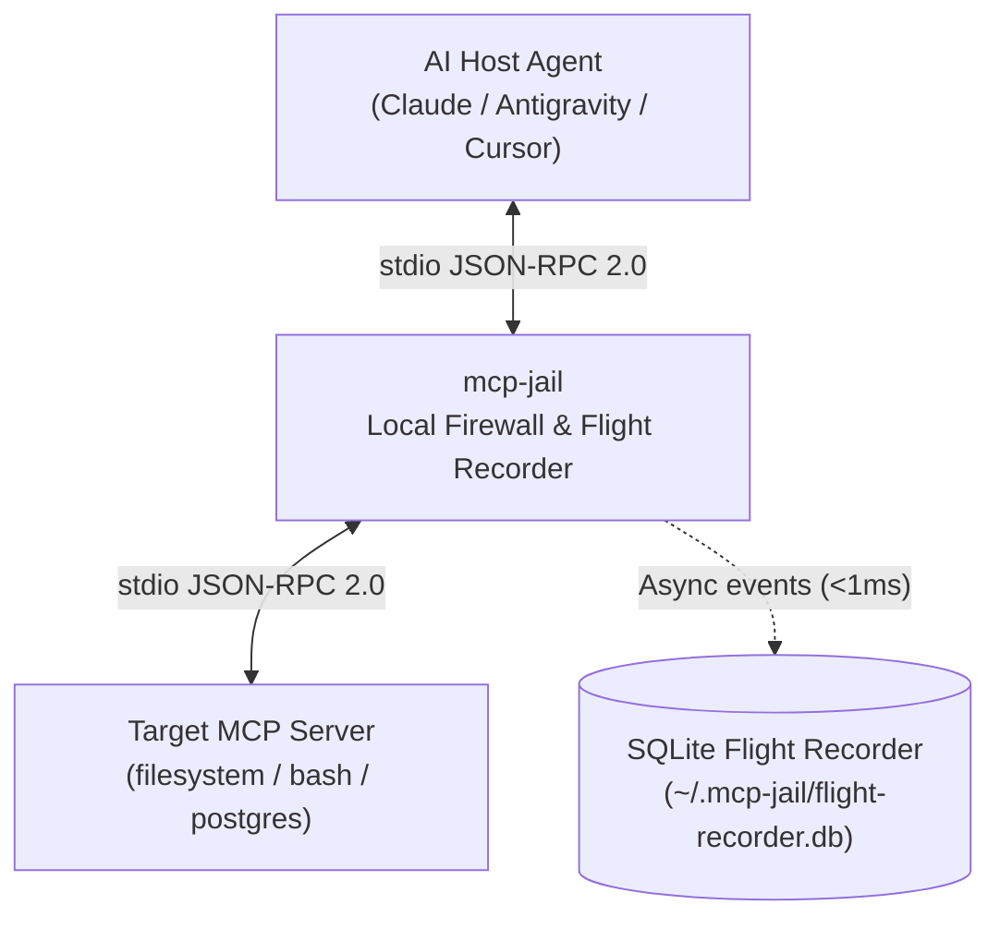

# mcp-jail Documentation

A lightweight security proxy and flight recorder for Model Context Protocol (MCP) servers and terminal AI coding agents.

Built as a single standalone binary in 100% pure Go—requiring no external C libraries, no database services, and no runtime dependencies to install.

---

## Overview

AI coding agents (such as Claude Code, Antigravity, Cursor, and OpenCode) execute MCP servers as local subprocesses communicating via line-delimited JSON-RPC 2.0 over `stdin` and `stdout`.

`mcp-jail` sits transparently between the Host Agent and the Target MCP Server to enforce security boundaries, prevent catastrophic command execution, prevent runaway token loops, and redact outbound credentials before they enter the LLM context window.



---

## Why mcp-jail?

### Problems It Solves
1. **Accidental File & System Destruction**: Autonomous agents attempting to run shell commands or clean up files can inadvertently execute destructive commands like `rm -rf`, `git push --force`, or cloud resource deletions.
2. **Directory Escapes & Sensitive Data Exposure**: MCP tools can wander outside the repository workspace, reading sensitive keys and credentials in `~/.ssh`, `~/.aws`, `~/.kube`, or `.env` files.
3. **Secrets Leaking into AI Prompts**: Database dumps, stack traces, and error logs frequently contain API keys, passwords, and tokens that get leaked into LLM prompts.
4. **Runaway Loops & Billing Spikes**: An agent trapped in a hallucination or retry loop can spam dozens of tool calls per second, consuming massive token budgets before you can intervene.
5. **Zero Visibility & Audit Trail**: Standard MCP connections run silently in the background with no persistent record of what commands were run, what data was returned, or what failed.

### Benefits You Get
- **Autonomous Coding with Peace of Mind**: Run AI agents autonomously knowing hard guardrails prevent destructive actions and keep the agent contained in your project.
- **Graceful Self-Correction (No Crashing)**: When a forbidden action is blocked, `mcp-jail` returns a structured error explaining the blockage so the LLM can self-correct and pick a safe alternative without aborting the session.
- **Automatic Secret Scrubbing**: Redacts AWS tokens, GitHub PATs, Slack/Stripe keys, private certificates, and high-entropy secrets before they reach the model.
- **Rate & Token Circuit Breakers**: Prevents runaway billing loops by enforcing hard limits on tool calls per minute, session calls, and token consumption.
- **Sub-Millisecond Flight Recorder**: Every interaction is logged to a fast local SQLite database with zero noticeable proxy latency (<1ms).
- **Single Standalone Binary**: 100% pure Go with no external C dependencies or database drivers required. Install via Homebrew and run immediately.

> [!IMPORTANT]
> **Strict Stdout Invariant**: When running in `wrap` mode, `mcp-jail` NEVER writes logs, panics, or debug output to `os.Stdout`. `os.Stdout` is strictly reserved for valid JSON-RPC 2.0 messages destined for the Host Agent. All internal logging routes to `os.Stderr` or the SQLite flight recorder.

---

## Navigation

- [Getting Started](getting-started.md) — Installation and initial configuration in 60 seconds.
- [Architecture](architecture.md) — Deep dive into the transparent stdio proxy and sub-millisecond async design.
- [Policy & Firewall Engine](policy-engine.md) — Tool allowlists, filesystem boundaries, and command guard regexes.
- [Secret Scrubber](secret-scrubber.md) — Outbound credential masking and Shannon entropy detection.
- [Flight Recorder & Audit](flight-recorder.md) — SQLite schema, audit trails, and querying events.
- [Client Integrations](clients.md) — Setup snippets for Claude Desktop, Claude Code, Cursor, and Antigravity.
- [Real-World Example: Home Assistant](examples-homeassistant.md) — Live walkthrough with screenshots of policy blocks and flight recorder logs.
- [CLI Reference](cli-reference.md) — Comprehensive reference for all subcommands and flags.

---

## Core Capabilities at a Glance

| Security Dimension | Enforcement Mechanism | Failure Response |
| :--- | :--- | :--- |
| **Tool Execution & Rules** | Regex Allowlist / Denylist + `args_rules` (regex & numeric ranges) | Graceful in-protocol `isError: true` JSON-RPC result |
| **Filesystem Boundary** | Realpath & symlink resolution against workspace roots | Blocks path traversal (`../`) and sensitive globs (`~/.ssh`, `~/.aws`, `.env*`) |
| **Command Guard** | Regex patterns for destructive commands (`rm -rf`, `git push --force`) | Refusal with actionable feedback |
| **Rate & Token Limiter** | Sliding window calls/min, total calls, and token budget | Circuit breaker trips to stop runaway agent loops |
| **Outbound Secrets** | Pattern regexes + Shannon entropy detector | Redacts credentials into `[REDACTED_BY_MCP_JAIL:<TYPE>]` |
| **Real-Time Alerts** | Native OS desktop popups (macOS / Linux) & webhooks (Slack/Discord) | Instant notification on policy blocks or approval denials |
| **Deterministic Replay** | SQLite-backed stdio mock server (`mcp-jail replay`) | Replays exact responses without touching child servers or live APIs |
| **Environment Doctor** | Pre-flight diagnostics (`mcp-jail doctor`) | Comprehensive verification of clients, servers, and sandbox readiness |
| **Audit Trail & SIEM** | Pure-Go SQLite in WAL mode + multi-format export (`json`, `cef`, `logfmt`) | Instant zero-latency recording with live streaming (`logs -f`) |

---

## Quick Example

Generate a security policy and protect any MCP server:

```bash
# 1. Run pre-flight environment checks
mcp-jail doctor

# 2. Initialize a tailored policy preset (coding, database, github, homeassistant, minimal)
mcp-jail init --preset coding

# 3. Auto-discover or wrap your MCP server
mcp-jail list
mcp-jail wrap -- npx -y @modelcontextprotocol/server-filesystem .

# 4. Stream audit logs live in another terminal window
mcp-jail logs -f

# 5. Deterministically replay sessions for offline testing
mcp-jail replay --list
mcp-jail replay <session-id>
```

> [!TIP]
> Use `mcp-jail wrap --dry-run -- <command>` during initial testing to monitor and audit MCP server behavior without blocking any tool executions.
