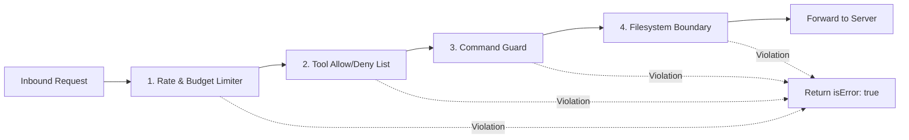

# Policy & Firewall Engine

`mcp-jail` evaluates every tool invocation against five layers of defensive middleware before forwarding requests to the child MCP server.

---

## Evaluation Pipeline



---

## 1. Tool Allow / Deny Lists

Restrict which tools the agent is permitted to execute:

```yaml
tools:
  # If allowed is non-empty, ONLY matching tool names are permitted
  allowed:
    - "^read_file$"
    - "^list_directory$"
    - "^git_status$"

  # Denied tools are always blocked
  denied:
    - "^format_disk$"
    - "^drop_database$"
    - "^delete_.*"
```

- Regex syntax supported.
- Tool names matching `denied` take precedence.

### Fine-Grained Parameter Constraints (`tools.rules`)

You can define granular argument-level constraints for matching tools, allowing tools only when their arguments satisfy safe boundaries:

```yaml
tools:
  rules:
    # 1. Deny dangerous arguments (e.g. database tools)
    - tool: ".*sql.*"
      deny_args:
        query: "(?i)\\b(DROP|TRUNCATE|ALTER\\s+USER)\\b"
      reason: "Destructive SQL statements are blocked"

    # 2. Allow only safe argument patterns (e.g. git branches)
    - tool: "git_push"
      allow_args:
        branch: "^(feature/|fix/).*"
      reason: "Direct push to protected branches is blocked"

    # 3. Numeric range constraints (e.g. speed, temperature, limits)
    - tool: "set_speed"
      range:
        speed:
          min: 0
          max: 100
```

---

## 2. Filesystem Boundary Enforcement

Prevents directory traversal, symlink escapes, and access to sensitive files.

```yaml
filesystem:
  enabled: true

  # Paths are resolved against working directory
  # Access outside allowed roots is blocked
  allowed_roots:
    - "."

  # Glob patterns denied even inside allowed roots
  denied_paths:
    - "**/.env*"
    - "~/.ssh/**"
    - "~/.aws/**"
    - "~/.kube/**"
    - "/etc/**"
    - "/var/run/**"
    - "~/.gnupg/**"
    - "**/*id_rsa*"
    - "**/*id_ed25519*"
    - "**/*.pem"
    - "**/*.key"
```

### Defense Mechanisms
1. **Recursive Glob Matching**: Supports `**` double-star globs (e.g. `**/.env*` matches `.env`, `backend/.env.local`, etc.).
2. **Path Traversal Resolution**: Resolves relative paths (`../`, `../../outside`) against `cwd` before evaluation.
3. **Symlink Resolution**: Calls `filepath.EvalSymlinks` to detect symlinks created inside the workspace that point to targets outside the allowed root.
4. **Tilde Home Expansion**: Automatically expands `~` to the user's home directory.

---

## 3. Command Argument Guard

Inspects string parameters passed to command execution tools (e.g., `bash`, `execute_command`, `exec`):

```yaml
commands:
  enabled: true
  denied_patterns:
    - 'rm\s+(-[a-zA-Z]*r[a-zA-Z]*f|-[a-zA-Z]*f[a-zA-Z]*r)\s+.*'
    - 'rm\s+-rf\s+.*'
    - 'curl\s+.*\|\s*(ba)?sh'
    - 'wget\s+.*\|\s*(ba)?sh'
    - 'git\s+push\s+.*--force'
    - 'aws\s+iam\s+.*'
    - 'terraform\s+destroy'
    - 'mkfs\..*'
    - 'dd\s+if=.*'
    - 'chmod\s+(-R\s+)?777\s+/'
```

---

## 4. Rate & Budget Limiter

Prevents runaway agent loops and unexpected token billing spikes:

```yaml
limits:
  # Max tool calls allowed within any sliding 60-second window
  max_tool_calls_per_minute: 60

  # Maximum cumulative tool calls permitted per session
  max_total_calls_per_session: 100

  # Maximum estimated response tokens before tripping circuit breaker
  max_session_tokens: 500000
```

> [!TIP]
> Tokens are approximated as `len(payload) / 4`. When limits are exceeded, subsequent requests receive a policy block response without terminating the server.

---

## 5. Dry-Run Mode

Test your rules without blocking actions:

```bash
mcp-jail wrap --dry-run -- <command>
```

In dry-run mode, violations are logged to the SQLite flight recorder with `(dry-run)` appended to the rule name, while the tool call is permitted to proceed.
