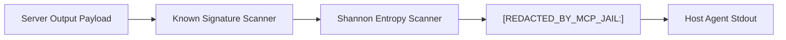

# Outbound Secret Scrubber

The Outbound Secret Scrubber prevents MCP servers from leaking credentials, API keys, and sensitive tokens into the LLM context window.

---

## How It Works

Before any JSON-RPC response from the child MCP server is forwarded to the Host Agent's `stdout`, `mcp-jail` executes high-speed regex matching and Shannon entropy detection on the payload.



---

## Supported Credential Patterns

| Credential Type | Pattern Matched | Replacement Tag |
| :--- | :--- | :--- |
| **AWS Access Key** | `AKIA[0-9A-Z]{16}` | `[REDACTED_BY_MCP_JAIL:AWS_KEY]` |
| **AWS Secret Key** | `aws_secret_access_key = ...` | `[REDACTED_BY_MCP_JAIL:AWS_SECRET]` |
| **GitHub Classic PAT** | `ghp_[a-zA-Z0-9]{36}` | `[REDACTED_BY_MCP_JAIL:GITHUB_PAT]` |
| **GitHub Fine-Grained PAT** | `github_pat_[a-zA-Z0-9]{22}_[a-zA-Z0-9]{59}` | `[REDACTED_BY_MCP_JAIL:GITHUB_PAT]` |
| **GitHub OAuth / App** | `gh[osru]_[a-zA-Z0-9]{36}` | `[REDACTED_BY_MCP_JAIL:GITHUB_TOKEN]` |
| **Slack Token** | `xox[baprs]-[0-9a-zA-Z]{10,48}` | `[REDACTED_BY_MCP_JAIL:SLACK_TOKEN]` |
| **Private Keys** | `-----BEGIN [A-Z0-9 ]*PRIVATE KEY-----` | `[REDACTED_BY_MCP_JAIL:PRIVATE_KEY]` |
| **Stripe Secret Keys** | `(sk|pk)_(live|test)_[0-9a-zA-Z]{24,99}` | `[REDACTED_BY_MCP_JAIL:STRIPE_KEY]` |
| **JWT Tokens** | Header.Payload.Signature format | `[REDACTED_BY_MCP_JAIL:JWT]` |
| **Generic Secret Assignments** | `api_key = "..."`, `token: "..."` | `[REDACTED_BY_MCP_JAIL:API_KEY]` |

---

## Shannon Entropy Detector

Even if a secret does not match known prefix signatures, `mcp-jail` detects high-entropy tokens:

$$\text{Entropy} = -\sum_{i} P(c_i) \log_2 P(c_i)$$

- Evaluates contiguous alphanumeric tokens $\ge 28$ characters.
- Threshold of $\ge 4.6$ bits per character flags randomized base64 and hex credentials.
- Replaces unclassified high-entropy strings with `[REDACTED_BY_MCP_JAIL:HIGH_ENTROPY]`.

---

## Configuration

In `.mcp-jail.yaml`:

```yaml
scrubber:
  enabled: true
  redact_patterns: true
  redact_entropy: true
  
  # Custom regex patterns
  custom_patterns:
    - name: "Internal DB Password"
      regex: 'db_pass_[a-zA-Z0-9]{24}'
    - name: "Company Token"
      regex: 'acme_live_[0-9a-f]{32}'
```

Custom patterns generate replacement tags matching the format `[REDACTED_BY_MCP_JAIL:<NAME_IN_CAPS>]`.
